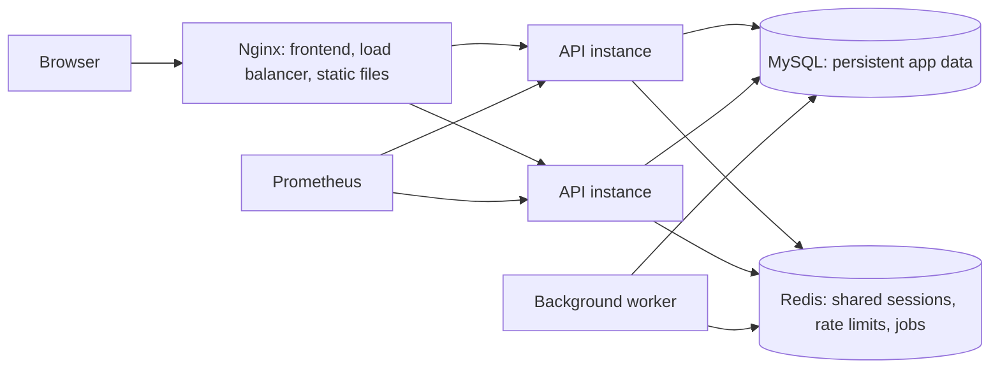

# Tracklap scaling guide

This guide describes the scaling changes in this project in everyday terms: what each part does, why it helps, and how to use it. These changes prepare the app to run as multiple services; they do not prove a particular user capacity. Measure performance in an environment similar to the one you plan to deploy.

## How the pieces fit together



Nginx sends API requests to available API instances. Those instances share MySQL and Redis, so a user's session and rate-limit counters do not depend on which instance receives a request. Prometheus collects service measurements; a separate worker handles scheduled cleanup work.

## What was added

| Part | What it does | Why it helps | Main files |
| --- | --- | --- | --- |
| Configurable MySQL pool | Limits simultaneous database connections and queued requests per API process. | Protects MySQL from unlimited connection growth; a full queue fails with a retryable `503`. | `backend/src/db.js`, `backend/src/app.js` |
| Redis session cache | Caches successful session lookups briefly; MySQL remains the durable source of truth and fallback. | Reduces repeated session reads from MySQL when Redis is available. | `backend/src/redis.js`, `backend/src/auth/sessions.js` |
| Shared rate limits | Stores login, registration, and AI request counters in Redis when configured. | Applies the same limit across API instances. Without Redis, each process uses its own in-memory limit. | `backend/src/security.js`, `backend/src/auth/routes.js`, `backend/src/ai/routes.js` |
| Versioned migrations | Runs schema creation and upgrades via a separate command, and records the applied version. API startup checks the version without changing the schema. | Avoids every API replica trying to run database changes at startup. Run a migration once before deploying new API instances. | `backend/src/migrations.js`, `backend/migrate.js` |
| Task cursor pagination | Reads tasks in ordered pages of up to 200 rows. The frontend requests subsequent pages to retain the app's current complete task views. | Bounds each database query and response. The browser still keeps all of that user's tasks in memory. | `backend/src/tasks/routes.js`, `src/pages/WorkspacePage.jsx` |
| Background job queue | BullMQ uses Redis to schedule and retry hourly expired-session cleanup. | Moves recurring cleanup out of each API process and provides a queue foundation for future slow, non-interactive work. | `backend/worker.js` |
| Health checks and metrics | Exposes liveness/readiness endpoints and Prometheus metrics for API requests, latency, process health, MySQL pool use, and queued jobs. | Helps identify outages, slow requests, and database or worker backlog. | `backend/src/app.js`, `backend/src/metrics.js` |
| Alert rules | Prometheus evaluates rules for API outage/error rate, latency, MySQL waiting requests, and job backlog. | Makes common operational problems visible on Prometheus's Alerts page. No notification service is configured. | `monitoring/prometheus.yml`, `monitoring/alerts.yml` |
| Container deployment | Compose defines MySQL, Redis, API, worker, Nginx, and Prometheus. Nginx distributes API requests and sets long cache headers on fingerprinted frontend assets. | Gives the services a repeatable deployment shape and supports multiple API replicas. | `docker-compose.yml`, `Dockerfile`, `backend/Dockerfile`, `nginx/default.conf` |
| Load-test scenario | k6 signs in virtual users, then repeatedly checks their sessions and task lists. | Measures response times and failure rates in an environment you run. | `backend/load/k6-login.js` |

## Settings to know

Backend settings are in `backend/.env` for local development. `backend/.env.example` contains placeholders. The Compose deployment reads a root `.env`, copied from `compose.env.example`.

- `MYSQL_CONNECTION_LIMIT`: maximum open MySQL connections for **each API process** (default `10`). If you run 3 API replicas at 10 each, budget for up to 30 API connections, plus the worker, migrations, and any other database clients.
- `MYSQL_QUEUE_LIMIT`: maximum requests waiting for a pooled connection per API process (default `100`). Keeping this bounded helps apply backpressure when MySQL is overloaded.
- `REDIS_URL`: Redis connection string. Compose sets this to its internal Redis service. Local development can leave it blank and use the MySQL/in-process fallback.
- `REDIS_REQUIRED`: set to `true` in a deployment that depends on shared Redis. Readiness then fails if Redis is unavailable.
- `AUTH_RATE_LIMIT_MAX`: login and registration attempts allowed from one client IP per 15 minutes (default `10`). Only raise it in a controlled load-test environment when the test needs more login attempts.
- `TRUST_PROXY_HOPS`: number of trusted reverse proxies in front of the API. Compose uses `1` because Nginx is the API's proxy. Keep this matched to the actual network path.
- `METRICS_TOKEN`: optional bearer token for `/metrics` if you expose the API metrics endpoint beyond a private network. Compose does not expose that endpoint publicly.

## Run locally

1. Set up MySQL and configure `backend/.env`.
2. From the project root, run `npm run migrate --prefix backend` once.
3. Start the API from `backend` with `npm run dev`.
4. Start the frontend from the project root with `npm run dev`.

Local mode does not require Redis. Without Redis, session checks use MySQL and rate limiting is process-local. The background worker needs Redis and can be started with `npm run worker` from `backend` when `REDIS_URL` is configured.

## Run the container stack

Docker and Docker Compose are required. Copy `compose.env.example` to `.env`, then replace both database password placeholders with strong, unique values. From the project root:

```sh
docker compose build
docker compose up -d mysql redis
docker compose --profile maintenance run --rm migrate
docker compose up -d --scale api=2
```

Open the app at `http://localhost:8080`. Prometheus is available only on the local machine at `http://localhost:9090`. Nginx distributes requests among API containers discovered through Docker DNS. Increase or decrease the API replica count with `--scale api=N`; remember that every replica adds its own MySQL pool.

To deploy publicly, put a TLS-enabled hosting load balancer or reverse proxy in front of Nginx. The Nginx rules already cache content-hashed `/assets/*` files for a year and revalidate `index.html`. A CDN can use the same policy: cache `/assets/*`, revalidate `/index.html`, and keep authenticated API responses and private profile photos out of public caches. No CDN account or provider has been configured in this project.

## Run the load-test scenario

Install k6 and create a dedicated test account with disposable data. Against the local Compose stack, run:

```sh
k6 run \
  -e BASE_URL=http://localhost:8080 \
  -e TEST_EMAIL=load-test@example.com \
  -e TEST_PASSWORD=your-test-password \
  -e VUS=10 \
  backend/load/k6-login.js
```

The script logs in once per virtual user and then requests the current session and task list. It checks that fewer than 2% of requests fail and that the overall 95th-percentile response time stays under one second. These are starting thresholds, not a capacity guarantee. Use test accounts, do not run against production data, and only adjust the login rate limit in an isolated test deployment.

This load test was added but has not been run here. Docker was unavailable in the development environment, so the Compose deployment and Prometheus configuration have not been exercised here either.

## Current boundaries

- The workspace fetches task pages until it has the complete task set, because Overview, Reports, Calendar, search, and counts currently depend on that set. Pagination bounds individual SQL queries and responses but does not yet reduce total browser memory or total task data transferred. Fully server-side task views would need page-specific fetching and summary endpoints.
- The queue currently runs session cleanup only. It is a foundation for future long-running jobs; no user-facing feature has been moved to a background job.
- Prometheus evaluates alert rules, but no Alertmanager, email, Slack, or paging destination is configured.
- Nginx provides load balancing and CDN-compatible cache headers. A real cloud load balancer, TLS certificate, and CDN distribution still need to be configured with the selected hosting provider.
- No throughput or concurrency target has been measured. Run the load scenario on production-like hardware and inspect Prometheus metrics before estimating capacity.
